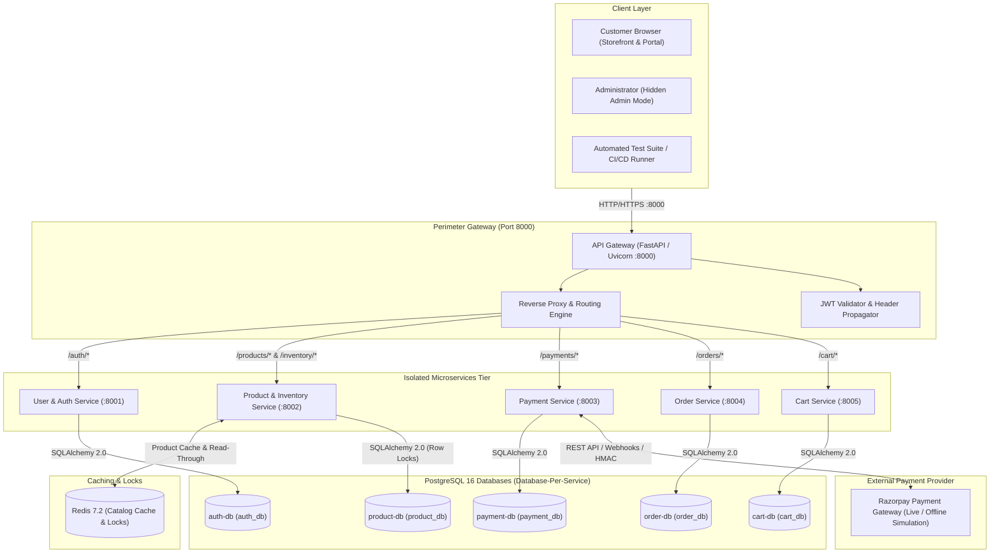
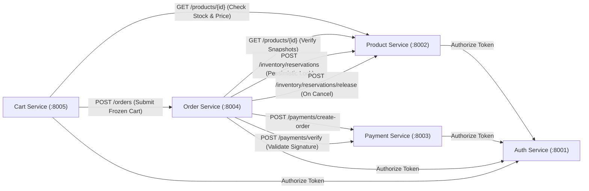
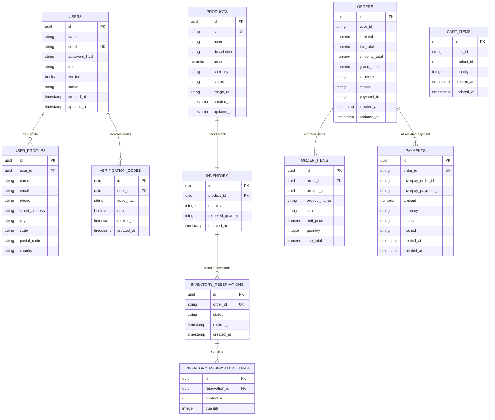
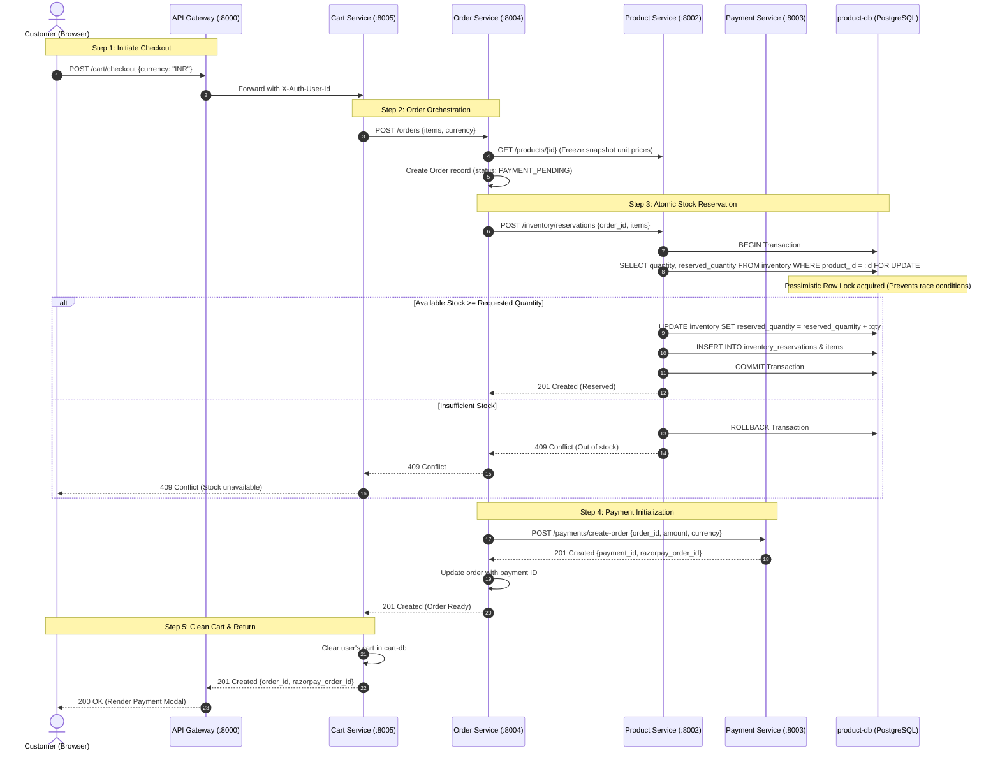
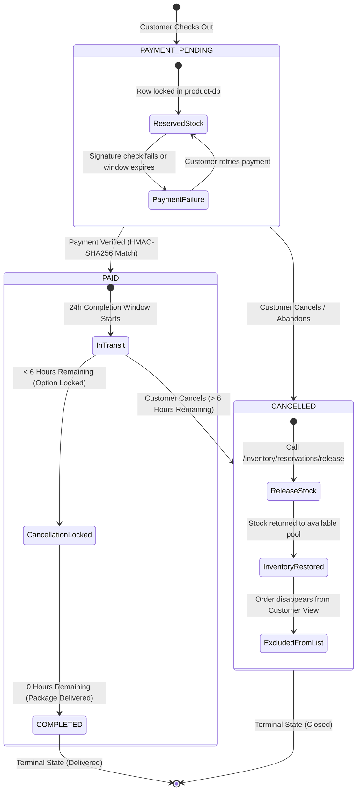
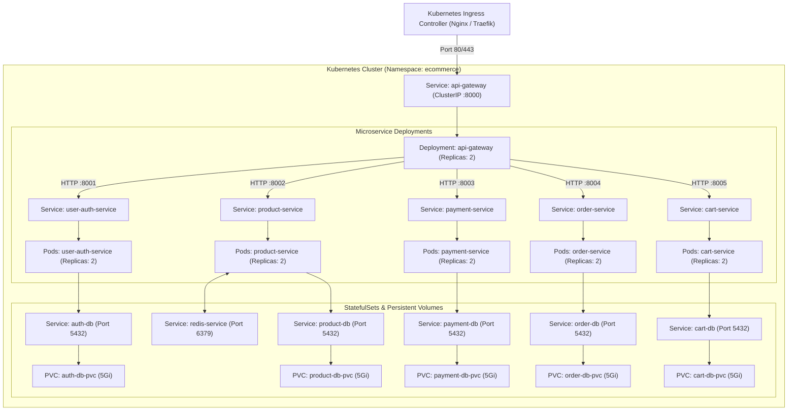
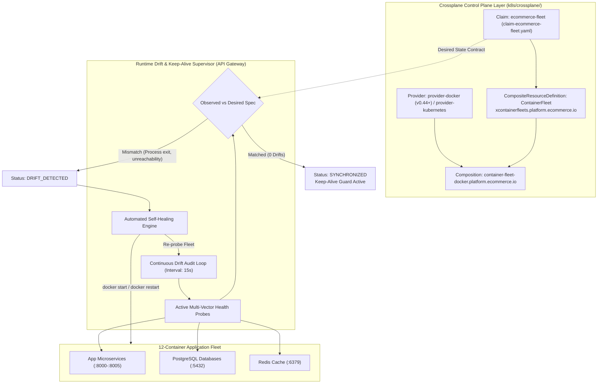

# E-Commerce Microservices System Architecture & Diagrams

Comprehensive architectural documentation for the E-Commerce Platform, capturing system topology, domain boundaries, data models, distributed transaction orchestration, security architecture, and deployment specifications.

---

## 📑 Table of Contents
1. [High-Level System & Network Topology](#1-high-level-system--network-topology)
2. [Microservices Domain & Inter-Service Communication](#2-microservices-domain--inter-service-communication)
3. [Complete Database Entity-Relationship (ER) Diagram](#3-complete-database-entity-relationship-er-diagram)
4. [Distributed Checkout Saga & Inventory Locking](#4-distributed-checkout-saga--inventory-locking)
5. [Order Lifecycle & 6-Hour Cancellation Lock State Machine](#5-order-lifecycle--6-hour-cancellation-lock-state-machine)
6. [Security & Authentication Architecture](#6-security--authentication-architecture)
7. [Kubernetes Cluster Deployment Architecture](#7-kubernetes-cluster-deployment-architecture)
8. [Crossplane Continuous Drift Detection & Keep-Alive Architecture](#8-crossplane-continuous-drift-detection--keep-alive-architecture)

---

## 1. High-Level System & Network Topology

The platform enforces database-per-service isolation across 5 dedicated PostgreSQL 16 databases and an ephemeral Redis instance. The **API Gateway** acts as the single secure public reverse proxy and perimeter gateway.

---

## 2. Microservices Domain & Inter-Service Communication

Services communicate over an internal network using REST APIs with propagated security headers (`X-Auth-User-Id`, `X-Auth-User-Role`).

---

## 3. Complete Database Entity-Relationship (ER) Diagram

The system comprises 11 tables distributed across 5 databases with referential integrity maintained within each service boundary.

---

## 4. Distributed Checkout Saga & Inventory Locking

Sequence diagram of the distributed transaction during checkout, showing PostgreSQL `SELECT ... FOR UPDATE` row locking to prevent race conditions and overselling.

---

## 5. Order Lifecycle & 6-Hour Cancellation Lock State Machine

State machine governing order statuses, completion countdowns, the 6-hour cancellation lock, and automatic inventory release.

---

## 6. Security & Authentication Architecture

Details the multi-tiered defense strategy: JWT bearer authentication, scrypt password hashing, the hidden administrative gate, and cryptographic payment verification.

```mermaid
flowchart TD
    subgraph AuthPipeline["1. Customer Authentication"]
        Reg["POST /auth/register"] --> ScryptHash["Hash password with scrypt (16-byte random salt)"]
        ScryptHash --> StoreUser["Store User (status: PENDING, verified: false)"]
        StoreUser --> CodeGen["Generate 6-digit numeric verification code"]
        CodeGen --> VerifyEmail["POST /auth/verify-email (Code validated via HMAC compare)"]
        VerifyEmail --> UserActive["User marked ACTIVE & VERIFIED"]
        UserActive --> Login["POST /auth/login"]
        Login --> IssueJWT["Issue HS256 JWT Token (Claims: sub, role, email)"]
    end

    subgraph AdminGate["2. Encapsulated Hidden Admin Gate"]
        Trigger["Secret Hotkey: Ctrl+Shift+A / 5x Logo Click / ?admin_gate=1"] --> Prompt["Restricted Access Authentication Modal"]
        Prompt --> AdminAuth["POST /auth/login (Requires ADMIN Role)"]
        AdminAuth --> CheckRole{"Role == 'ADMIN'?"}
        CheckRole -- No --> Deny["HTTP 403 Forbidden (Audit Logged)"]
        CheckRole -- Yes --> Unlock["Unlock Dark Theme Catalog Inventory Control"]
    end

    subgraph PaymentSecurity["3. Cryptographic Payment Verification"]
        SubmitSig["Customer submits payment details & signature"] --> PostVerify["POST /orders/{id}/payment/verify"]
        PostVerify --> SignatureCheck{"Verification Mode"}
        SignatureCheck -- Live --> HMACVal["HMAC-SHA256(order_id + '|' + payment_id, secret)"]
        SignatureCheck -- Sandbox --> SimVal["Simulated Sandbox Signature Match"]
        HMACVal --> Success["Payment Confirmed -> Order Marked PAID"]
        SimVal --> Success
    end
```

---

## 7. Kubernetes Cluster Deployment Architecture

Production topology deployed on a Kubernetes cluster with isolated namespaces, Services, Ingress, and persistent volume storage.

---

## 8. Crossplane Continuous Drift Detection & Keep-Alive Architecture

The infrastructure uses **Crossplane** Custom Resources (`XRD`, `Composition`, `Claim`) to define and enforce continuous drift detection and container self-healing across the 12-container fleet.

### Declarative Crossplane Resources
1. **`k8s/crossplane/providers.yaml`**: Installs Crossplane providers for Docker and Kubernetes to manage container instances directly via Kubernetes declarative semantics.
2. **`k8s/crossplane/xrd-container-fleet.yaml`**: Defines the `CompositeResourceDefinition` `ContainerFleet` with schema validation for desired containers, keep-alive guard policy, probe intervals, and drift status reports.
3. **`k8s/crossplane/composition-container-fleet.yaml`**: Composes the 12 containers into a unified composite resource with declarative environment variables, port mappings, volume mounts, and network links.
4. **`k8s/crossplane/claim-ecommerce-fleet.yaml`**: The operational claim requesting continuous monitoring (`driftDetectionInterval: 15s`, `keepAliveUntilClose: true`, `autoHealOnDrift: true`).
5. **Runtime Drift Supervisor**: Implemented in [`services/api-gateway/crossplane_drift_controller.py`](file:///Users/jayanthanayak/Ecommerce_Microservices_Kubernetes/services/api-gateway/crossplane_drift_controller.py) to actively evaluate the desired Crossplane fleet specification, expose live endpoints (`/health/crossplane-drift`, `/health/crossplane-drift/reconcile`), and power the Admin Console's Crossplane drift audit card.
