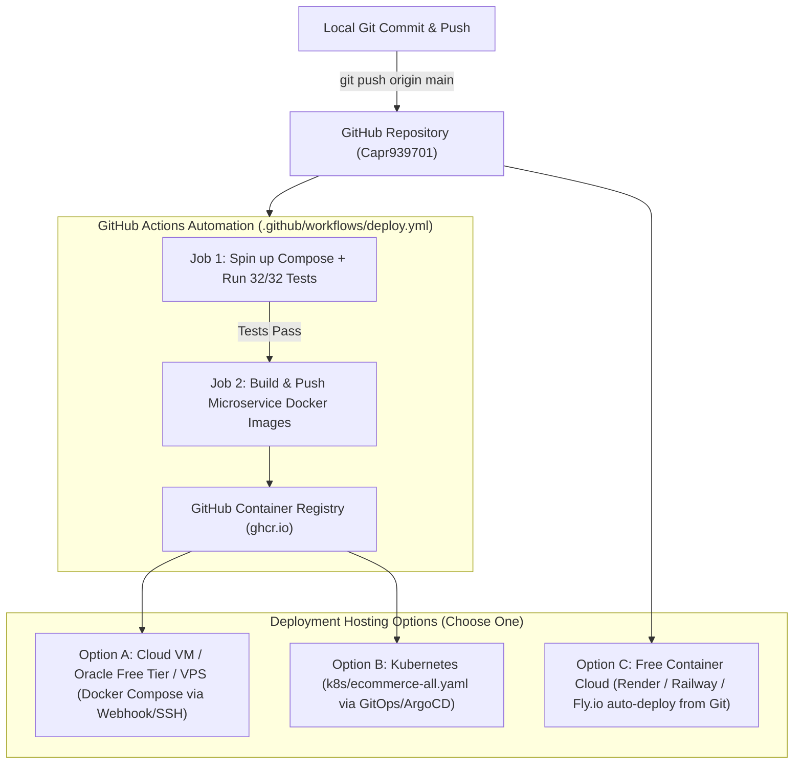

# GitHub Deployment Guide

This guide explains how to deploy the **E-Commerce Microservices** platform using GitHub.

---

## 1. Automated Deployment Architecture via GitHub



---

## 2. Option A: Free PaaS One-Click Deployment (Render / Railway)

The simplest way to run your microservices live directly from GitHub for free:

1. **Connect GitHub:**
   - Go to [Render.com](https://render.com) or [Railway.app](https://railway.app) and sign in with your GitHub account (`Capr939701`).
2. **Import Repository:**
   - Select `Ecommerce_Microservices_Kubernetes`.
3. **Deploy with Blueprint / Docker:**
   - Both platforms automatically detect your repository and `docker-compose.yml` or individual `Dockerfile` manifests.
   - Every time you push to `main`, GitHub notifies the platform via webhook to automatically rebuild and redeploy with zero downtime.

---

## 3. Option B: Automated Deploy to Any Linux VM (Oracle Free Tier / DigitalOcean / EC2)

Deploy the full Docker Compose stack to any server automatically every time you push code:

### Step 1: Install Docker on the Server
SSH into your remote server once:
```bash
git clone https://github.com/Capr939701/Ecommerce_Microservices_Kubernetes.git
cd Ecommerce_Microservices_Kubernetes
chmod +x run.sh stop.sh
./run.sh
```

### Step 2: Auto-Update via GitHub Actions
Add your server's SSH key to your GitHub repository secrets (`Settings` $\to$ `Secrets and variables` $\to$ `Actions`):
- `SERVER_HOST`: Your server IP
- `SERVER_USER`: e.g. `ubuntu`
- `SERVER_SSH_KEY`: Your private SSH key

Add this CD step to `.github/workflows/deploy.yml`:
```yaml
      - name: Deploy to Remote Server
        uses: appleboy/ssh-action@master
        with:
          host: ${{ secrets.SERVER_HOST }}
          username: ${{ secrets.SERVER_USER }}
          key: ${{ secrets.SERVER_SSH_KEY }}
          script: |
            cd Ecommerce_Microservices_Kubernetes
            git pull origin main
            docker compose down
            docker compose up -d --build
            python3 scripts/bootstrap.py
```

---

## 4. Option C: Production Kubernetes Deployment (GitOps with ArgoCD)

If deploying to a Kubernetes cluster:
1. Apply the cluster manifest:
   ```bash
   kubectl apply -f k8s/ecommerce-all.yaml
   ```
2. Connect **ArgoCD** to your GitHub repo `https://github.com/Capr939701/Ecommerce_Microservices_Kubernetes`.
3. Whenever you push changes to `k8s/ecommerce-all.yaml` in GitHub, ArgoCD automatically syncs and performs a rolling zero-downtime update.

---

## 5. How to Trigger Deployment Right Now

1. Stage and commit your changes:
   ```bash
   git add .
   git commit -m "feat: complete market pricing in rupees, HA automation, and CI/CD pipeline"
   ```
2. Push to GitHub:
   ```bash
   git push origin main
   ```
3. Visit the **Actions** tab in your repository:
   `https://github.com/Capr939701/Ecommerce_Microservices_Kubernetes/actions`
   You will see the pipeline automatically spin up the full 12-container suite, run all 32 tests, and build container images.
