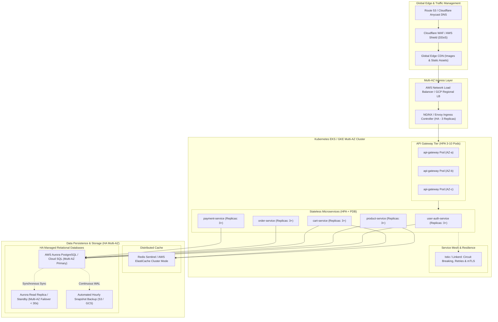

# High Availability (HA) & Site Reliability Engineering (SRE) Automation Blueprint

This blueprint outlines the production roadmap and concrete implementation steps to transform the **E-Commerce Microservices** platform from a local single-node deployment into an enterprise-grade, self-healing, highly available (**99.99% SLA**) architecture.

---

## 1. High Availability Architecture Topology



---

## 2. Five Pillars of Automation for High Availability & Reliability

| Pillar | Current State | Target HA / Reliability Architecture | Automation Mechanism |
| :--- | :--- | :--- | :--- |
| **1. Compute Elasticity** | Single pod / single container per service | Multi-AZ Horizontal Pod Autoscalers (HPA) with Pod Disruption Budgets (PDB) | K8s HPA auto-scales pods on CPU/memory & custom RPS metrics (3 to 15 pods per service) |
| **2. Database Resilience** | Single-node PostgreSQL StatefulSets | Managed Aurora Multi-AZ / Cloud SQL with automatic sub-30s failover | Synchronous streaming replication + automated failover election |
| **3. Traffic & Chaos Defense** | Direct HTTP calls between services | Circuit breaker pattern, exponential backoff, rate limiting & mTLS | Envoy / Istio service mesh + Tenacity exponential backoff retries |
| **4. Zero-Downtime Releases** | Manual docker compose restarts | Automated GitOps (ArgoCD) with Canary / Blue-Green releases | Argo Rollouts evaluating Prometheus error rates before routing 100% traffic |
| **5. Self-Healing & Observability** | Health probes (`/health`) on single node | Distributed tracing, auto-restart on probe failure, synthetic monitors | Prometheus, Grafana, OpenTelemetry + Datadog / PagerDuty automated alerts |

---

## 3. Concrete Automation Implementations

### A. Compute Auto-Scaling (HPA) & Pod Disruption Budgets (PDB)

To prevent downtime during node upgrades, cluster drains, or unexpected traffic surges, configure Horizontal Pod Autoscaling and Pod Disruption Budgets:

```yaml
# Example: k8s/hpa-api-gateway.yaml
apiVersion: autoscaling/v2
kind: HorizontalPodAutoscaler
metadata:
  name: api-gateway-hpa
  namespace: ecommerce
spec:
  scaleTargetRef:
    apiVersion: apps/v1
    kind: Deployment
    name: api-gateway
  minReplicas: 3
  maxReplicas: 10
  metrics:
  - type: Resource
    resource:
      name: cpu
      target:
        type: Utilization
        averageUtilization: 65
  - type: Resource
    resource:
      name: memory
      target:
        type: Utilization
        averageUtilization: 75
  behavior:
    scaleDown:
      stabilizationWindowSeconds: 300
      policies:
      - type: Percent
        value: 20
        periodSeconds: 60
    scaleUp:
      stabilizationWindowSeconds: 0
      policies:
      - type: Percent
        value: 100
        periodSeconds: 15
---
# Guarantee at least 2 replicas are running at all times
apiVersion: policy/v1
kind: PodDisruptionBudget
metadata:
  name: api-gateway-pdb
  namespace: ecommerce
spec:
  minAvailable: 2
  selector:
    matchLabels:
      app: api-gateway
```

### B. High Availability Database Automation (Multi-AZ Aurora / Cloud SQL)

For production, transition stateful database containers to cloud-managed PostgreSQL with multi-availability zone read replicas:
1. **Automated Sub-30s Failover:** Primary instance in `Zone A`, synchronous standby in `Zone B`. If `Zone A` fails, DNS automatically reroutes traffic to `Zone B` in under 30 seconds.
2. **Point-In-Time Recovery (PITR):** Continuous Write-Ahead Log (WAL) archiving to cloud object storage (Amazon S3 / Google Cloud Storage) with 1-second recovery granularity.
3. **Connection Pooling via PgBouncer:** Prevent connection exhaustion during autoscaling spikes by deploying HA PgBouncer proxies in front of PostgreSQL.

### C. Circuit Breakers & Dead Letter Queues (Asynchronous Reliability)

In inter-service REST communication (`api-gateway` $\to$ `order-service` $\to$ `payment-service`):
- **Fast Failures:** If a downstream service fails 5 consecutive calls or responds in $>2000\text{ms}$, open the circuit breaker immediately. Return fallback cached responses or polite queue confirmations.
- **Asynchronous Decoupling via Kafka / RabbitMQ:** Transition order creation and payment notification from synchronous HTTP chains to transactional message queues:
  - `Order Created` $\to$ Published to Kafka topic `orders.events`
  - `Payment Service` consumes at its own pace; failures redirect to Dead Letter Queue (DLQ) with automatic retry scheduler.

### D. Automated GitOps CI/CD Pipeline (GitHub Actions + ArgoCD)

1. **Continuous Integration (CI):**
   - Linting & static security analysis (`bandit`, `trufflehog`, `ruff`).
   - Unit tests & microservices integration tests (`bash scripts/test_all.sh`).
   - Container vulnerability scan (`trivy image`).
   - Push signed, immutable container images (`sha256`) to Amazon ECR / Artifact Registry.
2. **Continuous Deployment (CD) with Argo Rollouts:**
   - Detects new git tag or image digest.
   - Deploys Canary release routing 5% of traffic.
   - Prometheus analyzes HTTP 5xx error rate and latency percentiles ($p_{95} \le 150\text{ms}$, $p_{99} \le 300\text{ms}$).
   - **Automated Rollback:** If error rate exceeds 0.5%, ArgoCD rolls back to the previous stable release within 10 seconds without human intervention.

### E. Chaos Engineering & Synthetic Monitoring
- **Chaos Mesh / Gremlin:** Run scheduled chaos tests in staging (killing random pods, injecting 300ms network latency, simulating database failover) to prove the system automatically self-heals without user interruption.
- **Synthetic Transactions:** Run an automated headless runner every 60 seconds executing the entire purchase journey: Add to Cart $\to$ Checkout $\to$ Simulated Payment. If any step fails, trigger PagerDuty alerts immediately.
