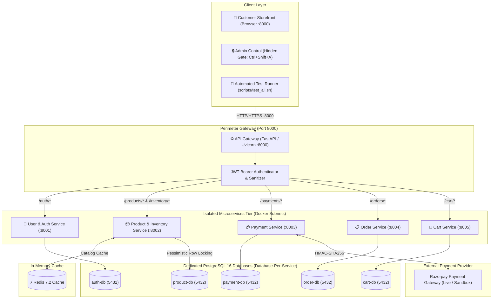
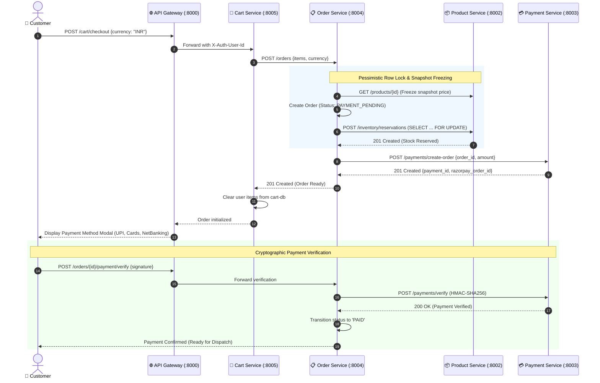
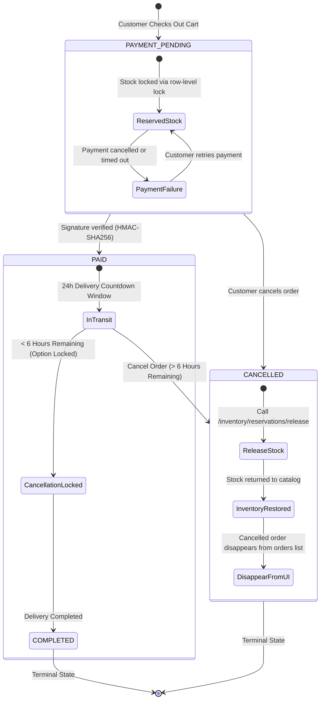
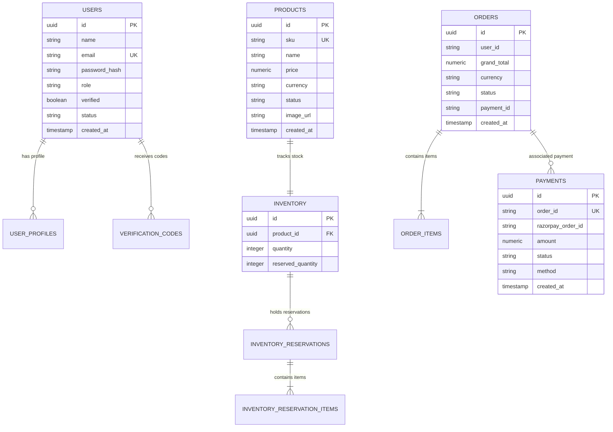

# E-Commerce Microservices Platform

[](https://codespaces.new/jayantha-nayak/ECommerce-Microservices-Docker-Site)

An enterprise-grade, event-driven e-commerce platform built with **FastAPI**, **PostgreSQL 16**, **Redis 7.2**, **Docker**, **Kubernetes**, and **Razorpay**. All services are decoupled behind a unified API Gateway with JWT-based authentication, network-isolated databases, pessimistic row locking, and an encapsulated customer storefront.

---

## 🏗️ System Architecture Diagrams

### 1. High-Level Network & Services Topology



#### ASCII Network View (Fallback / Raw Text)
```
                                 [ Client Traffic / Browser ]
                                              │
                                              ▼ (Port 8000)
                               ┌─────────────────────────────┐
                               │     Unified API Gateway     │
                               │  (FastAPI / Security Proxy) │
                               └──────────────┬──────────────┘
                                              │ Internal Bridge Subnets
          ┌──────────────────┬────────────────┼────────────────┬──────────────────┐
          ▼                  ▼                ▼                ▼                  ▼
 ┌─────────────────┐ ┌───────────────┐ ┌──────────┐ ┌──────────────┐ ┌─────────────────┐
 │User/Auth Service│ │Product Service│ │ Cart Svc │ │Order Service │ │ Payment Service │
 │   (Port 8001)   │ │  (Port 8002)  │ │ Port 8005│ │ (Port 8004)  │ │   (Port 8003)   │
 └────────┬────────┘ └───────┬───────┘ └────┬─────┘ └──────┬───────┘ └────────┬────────┘
          │ auth-net         │ prod-net     │cart-net      │ order-net        │ payment-net
          ▼                  ▼              ▼              ▼                  ▼
  ┌───────────────┐  ┌───────────────┐ ┌──────────┐ ┌──────────────┐  ┌───────────────┐
  │    auth-db    │  │  product-db   │ │ cart-db  │ │   order-db   │  │  payment-db   │
  │ (Postgres 16) │  │ (Postgres 16) │ │(Postgres)│ │(Postgres 16) │  │ (Postgres 16) │
  └───────────────┘  └───────────────┘ └──────────┘ └──────────────┘  └───────────────┘
```

---

### 2. Distributed Checkout Saga & Stock Locking



---

### 3. Order Lifecycle & 6-Hour Cancellation Rule



---

### 4. Database Entity-Relationship (ER) Diagram



---

## 📂 Microservices Directory & Ports

| Service | Port | Database | Primary Function |
|---|---:|---|---|
| **API Gateway** | `8000` | None | Unified entry point, JWT validation, reverse proxy, customer storefront, hidden admin gate |
| **User & Auth Service** | `8001` | `auth_db` | Registration, email verification, `scrypt` password hashing, JWT issuance |
| **Product & Inventory** | `8002` | `product_db` | Catalog CRUD, product image upload, `SELECT ... FOR UPDATE` row locking |
| **Payment Service** | `8003` | `payment_db` | Razorpay orders, HMAC-SHA256 signature verification, offline simulation mode |
| **Order Service** | `8004` | `order_db` | Multi-item checkout saga, 24h timer, 6h lock rule, order cancellation |
| **Cart Service** | `8005` | `cart_db` | Persistent customer cart, quantity validation, checkout transition |

---

## 🚀 Quick Start

### 1. Run the Entire Stack via Docker
```bash
docker compose up -d --build
```
Inspect health:
```bash
docker compose ps
```
All 12 containers (`api-gateway`, 5 services, 5 databases, `redis`) will report `(healthy)`.

### 2. Access the Storefront
Open in browser:
- **Customer Store:** [http://localhost:8000](http://localhost:8000)
- **API Documentation (Swagger):** [http://localhost:8000/docs](http://localhost:8000/docs)
- **Hidden Admin Gate:** Press `Ctrl + Shift + A` (or click logo 5x) $\to$ Password: `AdminPassword123!`

### 3. Run Automated Integration Tests (32/32 Passing)
```bash
bash scripts/test_all.sh
```

---

## 📑 Detailed Architecture Documentation
For deep-dive technical specs, review:
- [doc/ARCHITECTURE.md](file:///Users/jayanthanayak/Ecommerce_Microservices_Kubernetes/doc/ARCHITECTURE.md): Comprehensive 7-diagram architecture guide.
- [doc/flowchart.md](file:///Users/jayanthanayak/Ecommerce_Microservices_Kubernetes/doc/flowchart.md): Step-by-step workflow flowcharts.
- [scripts/export_csv_backup.py](file:///Users/jayanthanayak/Ecommerce_Microservices_Kubernetes/scripts/export_csv_backup.py): Database backup snapshot script.
