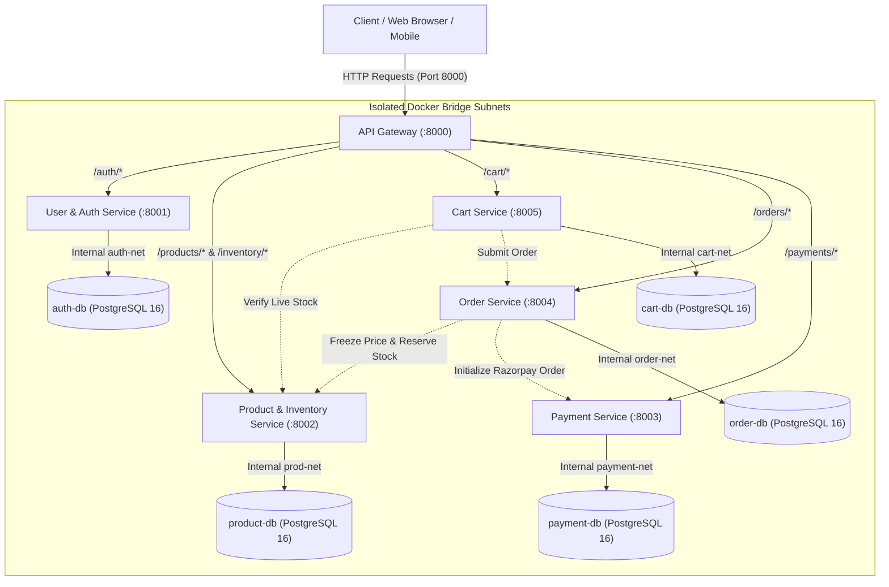
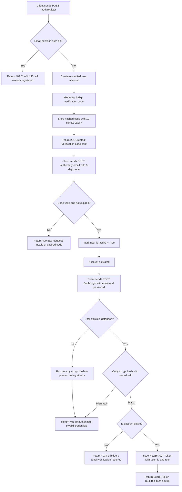
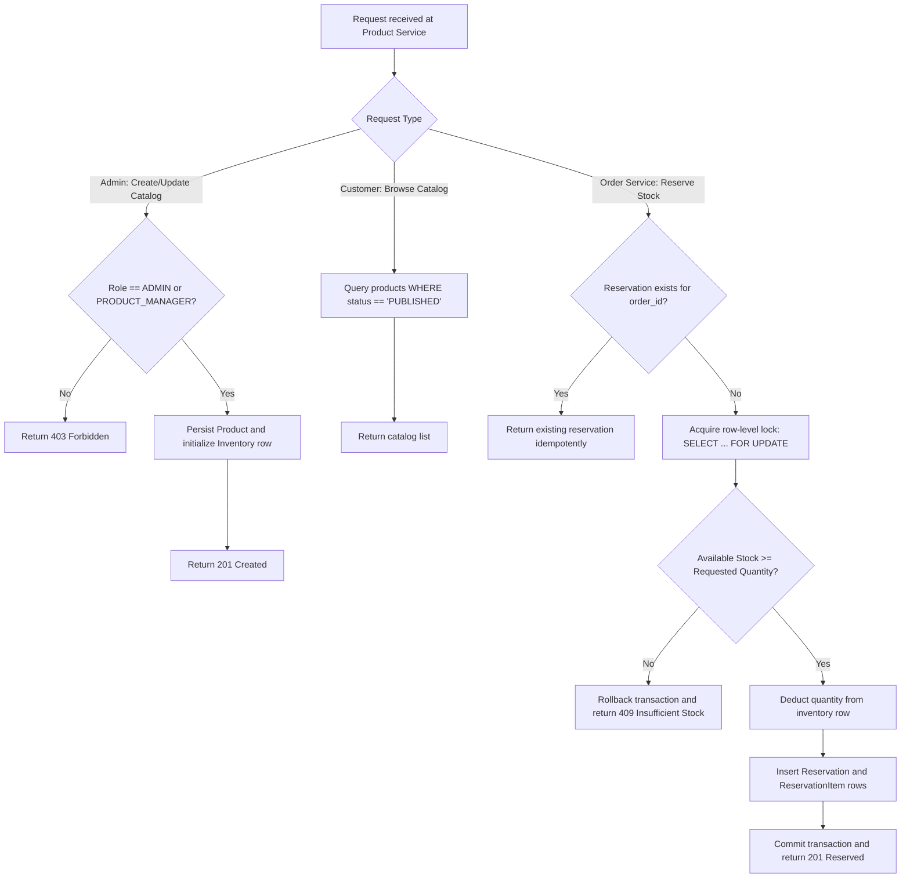
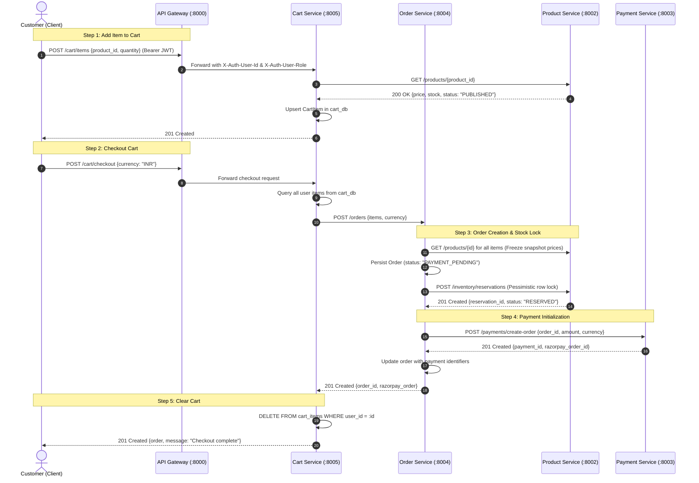
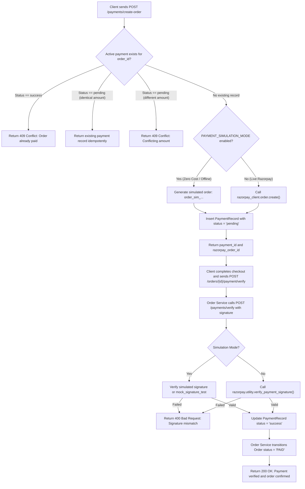
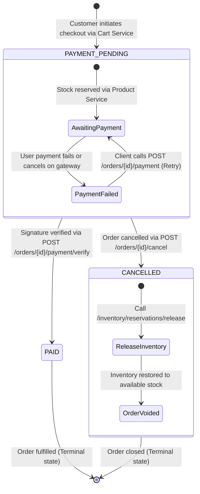

# E-Commerce Microservices Architecture & Flowcharts

This document provides visual flowcharts and state diagrams for all core business workflows, architectural boundaries, and transaction lifecycles across the e-commerce microservices platform.

---

## 📑 Table of Contents

1. [Master End-to-End Business Flowchart](#1-master-end-to-end-business-flowchart)
2. [High-Level System & Network Architecture](#2-high-level-system--network-architecture)
3. [User Registration & Authentication Flow](#3-user-registration--authentication-flow)
4. [Product Catalog & Inventory Reservation Flow](#4-product-catalog--inventory-reservation-flow)
5. [Shopping Cart & Checkout Saga Flow](#5-shopping-cart--checkout-saga-flow)
6. [Payment Processing & Cryptographic Verification Flow](#6-payment-processing--cryptographic-verification-flow)
7. [Order Lifecycle State Diagram](#7-order-lifecycle-state-diagram)

---

## 1. Master End-to-End Business Flowchart

This master flowchart visualizes the complete end-to-end customer journey from storefront discovery to order fulfillment:

```mermaid
flowchart TD
    subgraph Phase1["1. Storefront Discovery & Authentication"]
        A["Customer visits Web Storefront (Port 8000)"] --> B["GET /products (Browse Published Catalog)"]
        B --> C{"Has Existing Account?"}
        C -- "No" --> D["POST /auth/register (Create Account)"]
        D --> E["POST /auth/verify-email (Submit 6-Digit Code)"]
        E --> F["POST /auth/login (Submit Email & Password)"]
        C -- "Yes" --> F
        F --> G["Receive Bearer JWT Access Token"]
    end

    subgraph Phase2["2. Shopping Cart Management"]
        G --> H["POST /cart/items (Select Item & Quantity)"]
        H --> I["Cart Service calls Product Service: Verify Stock"]
        I --> J["GET /cart (Review Cart & Live Subtotals)"]
        J --> K["POST /cart/checkout (Submit Checkout Request)"]
    end

    subgraph Phase3["3. Order Orchestration & Stock Locking"]
        K --> L["Cart Service dispatches POST /orders"]
        L --> M["Order Service calls Product Service: Freeze Unit Prices"]
        M --> N["Persist Order in order-db (Status: PAYMENT_PENDING)"]
        N --> O["POST /inventory/reservations (Order ID key)"]
        O --> P["Product Service acquires Row Lock: SELECT ... FOR UPDATE"]
        P --> Q["Stock decremented atomically & Reservation persisted"]
    end

    subgraph Phase4["4. Payment & Order Confirmation"]
        Q --> R["Order Service calls Payment Service: POST /payments/create-order"]
        R --> S["Create Razorpay Order (Offline Simulation / Live)"]
        S --> T["Cart cleared in cart-db"]
        T --> U["Return Order Details & razorpay_order_id to Customer"]
        U --> V["Customer completes payment & submits signature"]
        V --> W["POST /orders/{id}/payment/verify"]
        W --> X["Payment Service validates HMAC-SHA256 Signature"]
        X --> Y["PaymentRecord status transitions to 'success'"]
        Y --> Z["Order status transitions to 'PAID'"]
        Z --> Done["Order Confirmed: Receipt issued to Customer"]
    end
```

---

## 2. High-Level System & Network Architecture

The architecture isolates all downstream microservices and databases on private Docker bridge subnets. The **API Gateway** acts as the single public entry point on port `8000`.

---

## 3. User Registration & Authentication Flow

Covers account creation, one-time email verification codes, password hashing via `scrypt` with random 16-byte salts, and JWT token issuance.

---

## 4. Product Catalog & Inventory Reservation Flow

Illustrates how product catalog creation works, along with atomic inventory stock reservations utilizing PostgreSQL `SELECT ... FOR UPDATE` pessimistic row locking.

---

## 5. Shopping Cart & Checkout Saga Flow

Demonstrates the distributed checkout orchestration across the Cart Service, Product Service, and Order Service.

---

## 6. Payment Processing & Cryptographic Verification Flow

Shows how Razorpay payment orders are created, idempotently handled, and verified using HMAC-SHA256 signatures or offline sandbox simulation mode.

---

## 7. Order Lifecycle State Diagram

The formal state machine governing an order from creation through payment confirmation or cancellation with compensating inventory release.

